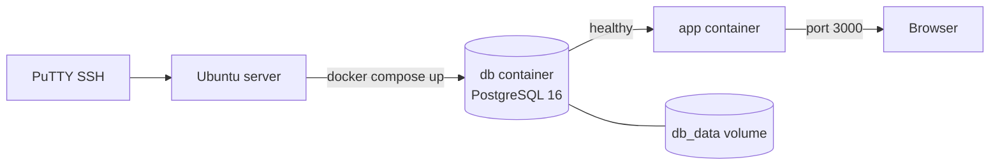
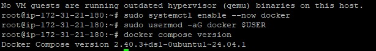
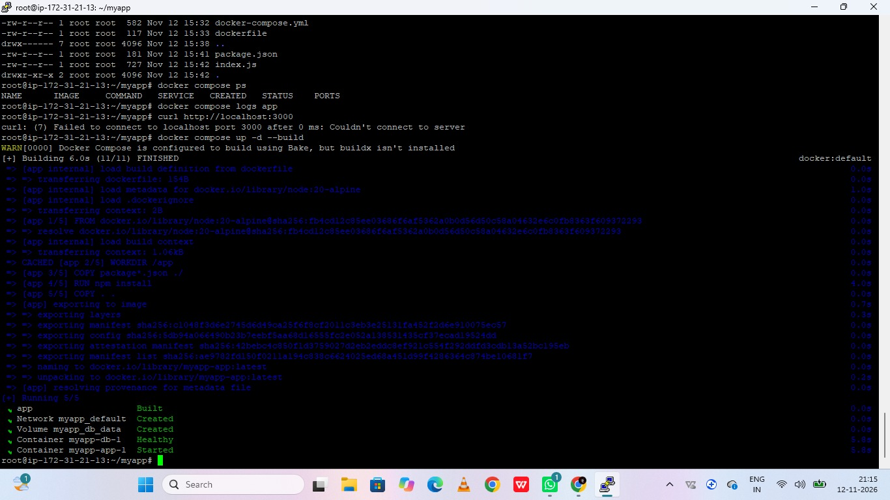
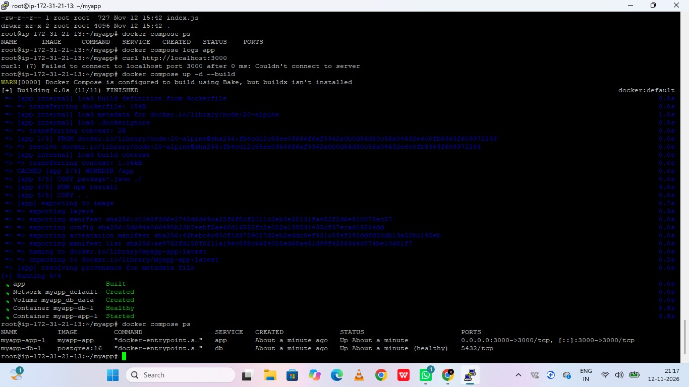
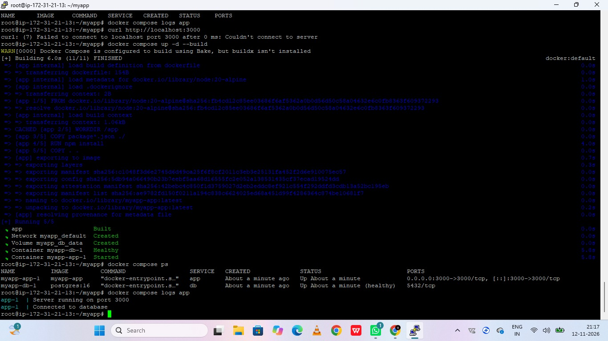
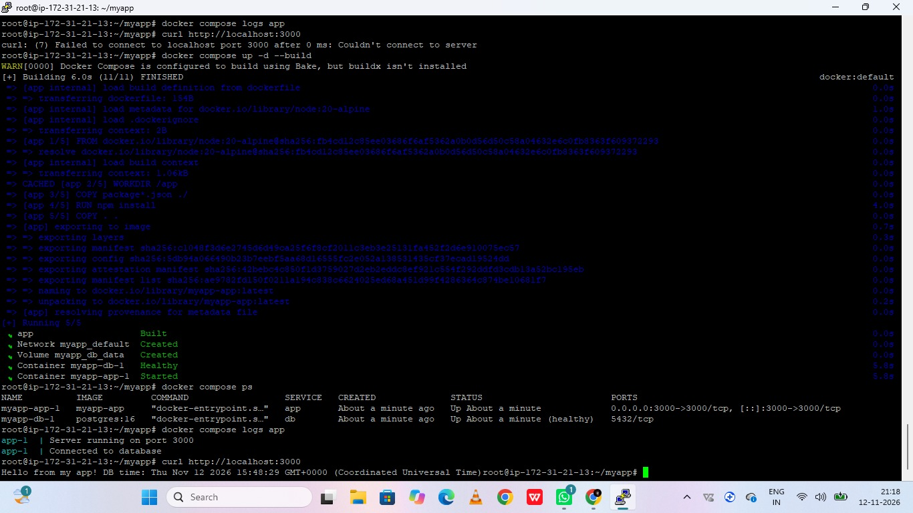
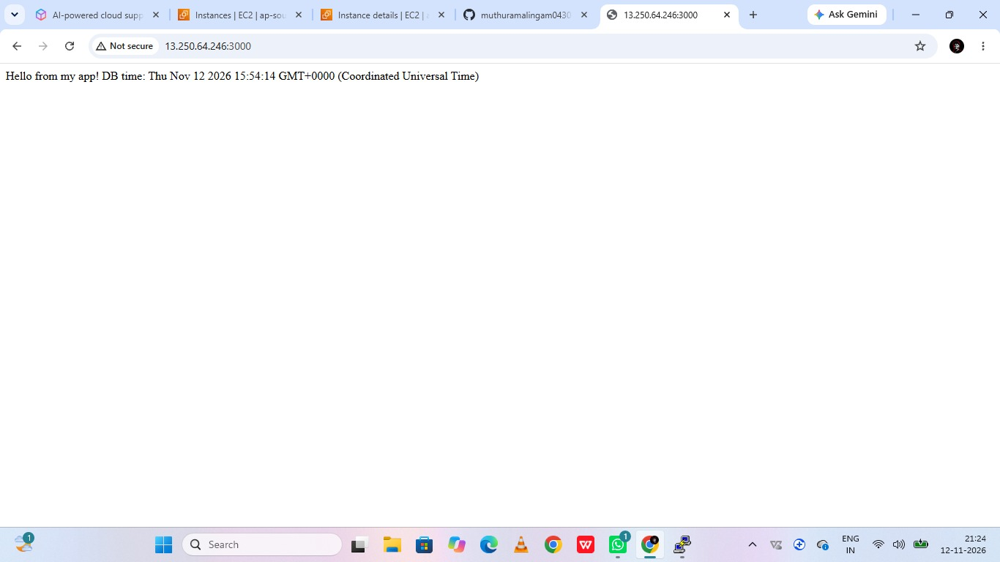
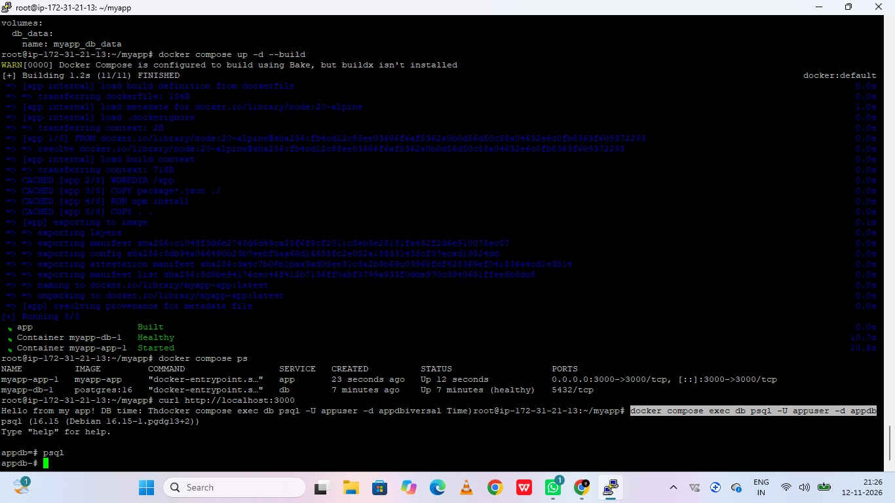

# Docker Compose Project (App + Database)

A simple project that runs a web app and a PostgreSQL database together using Docker Compose on Ubuntu.

**Author:** MUTHU RAMALINGAM S

## Project flow (animated)






## Project structure

```
myapp/
├── docker-compose.yml
├── Dockerfile
├── .env
├── package.json
└── index.js
```

## Prerequisites

- Ubuntu server (accessed through PuTTY)
- A user with `sudo` access
- Open port 3000 (or the port your app uses)

## Step 1: Connect to the server

1. Open PuTTY.
2. Enter the server IP address and port 22.
3. Click Open and log in with your username and password.

## Step 2: Install Docker and Docker Compose

```bash
sudo apt update
sudo apt install -y docker.io docker-compose-v2
sudo systemctl enable --now docker
sudo usermod -aG docker $USER
```

Log out of PuTTY and log in again, then verify:

```bash
docker --version
docker compose version
```

Output:



## Step 3: Get the project files

Clone from Git:

```bash
git clone <your-repo-url> myapp
cd myapp
```

Or create the folder manually and upload files with WinSCP:

```bash
mkdir ~/myapp && cd ~/myapp
```

## Step 4: Create the environment file

```bash
nano .env
```

```env
DB_USER=appuser
DB_PASSWORD=change_this_password
DB_NAME=appdb
```

Save with `Ctrl+O`, `Enter`, then exit with `Ctrl+X`.

## Step 5: Review docker-compose.yml

```yaml
services:
  app:
    build: .
    ports:
      - "3000:3000"
    environment:
      DB_HOST: db
      DB_USER: ${DB_USER}
      DB_PASSWORD: ${DB_PASSWORD}
      DB_NAME: ${DB_NAME}
    depends_on:
      db:
        condition: service_healthy
    restart: unless-stopped

  db:
    image: postgres:16
    environment:
      POSTGRES_USER: ${DB_USER}
      POSTGRES_PASSWORD: ${DB_PASSWORD}
      POSTGRES_DB: ${DB_NAME}
    volumes:
      - db_data:/var/lib/postgresql/data
    healthcheck:
      test: ["CMD-SHELL", "pg_isready -U ${DB_USER} -d ${DB_NAME}"]
      interval: 5s
      retries: 5

volumes:
  db_data:
```

What each part does:

| Part | Purpose |
|------|---------|
| `app` | Your application, built from the Dockerfile |
| `db` | PostgreSQL database |
| `DB_HOST: db` | The app reaches the database by its service name |
| `volumes` | Keeps database data after restarts |
| `healthcheck` | The app starts only after the database is ready |
| `ports` | Maps server port 3000 to container port 3000 |

## Step 6: Review the Dockerfile

Example for Node.js:

```dockerfile
FROM node:20-alpine
WORKDIR /app
COPY package*.json ./
RUN npm install
COPY . .
EXPOSE 3000
CMD ["node", "index.js"]
```

## Step 7: Build and start the project

```bash
docker compose up -d --build
```

Output (the build finishes, the database becomes healthy, then the app starts):



## Step 8: Check that everything is running

```bash
docker compose ps
docker compose logs -f app
```

Expected: both containers show `Up`, and the database shows `(healthy)`.

Container status (`docker compose ps`):



App logs (`docker compose logs app`), showing the server running and the database connected:



## Step 9: Open the firewall port

```bash
sudo ufw allow 3000
```

## Step 10: Test the application

On the server:

```bash
curl http://localhost:3000
```

Output:



In your browser:

```
http://<server-ip>:3000
```

Output:



## Step 11: Access the database

```bash
docker compose exec db psql -U appuser -d appdb
```

Type `\dt` to list tables and `\q` to exit.

Output:



## Useful commands

| Task | Command |
|------|---------|
| Stop containers | `docker compose stop` |
| Start containers | `docker compose start` |
| Restart the app | `docker compose restart app` |
| View logs | `docker compose logs -f` |
| Remove containers (data kept) | `docker compose down` |
| Remove containers and data | `docker compose down -v` |
| Rebuild after code changes | `docker compose up -d --build` |

## Troubleshooting

- **Permission denied on docker:** log out and back in after `usermod`, or prefix commands with `sudo`.
- **Port already in use:** change the left side of `ports`, for example `"3001:3000"`.
- **App cannot connect to the database:** check that `DB_HOST` is `db` and that the `.env` values match.
- **Container keeps exiting:** run `docker compose logs app` to see the error.

## Security notes

- Never commit `.env` to Git. Add it to `.gitignore`.
- Do not expose the database port publicly.
- Use a strong database password.
